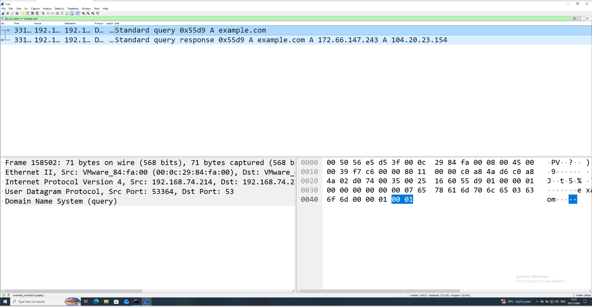
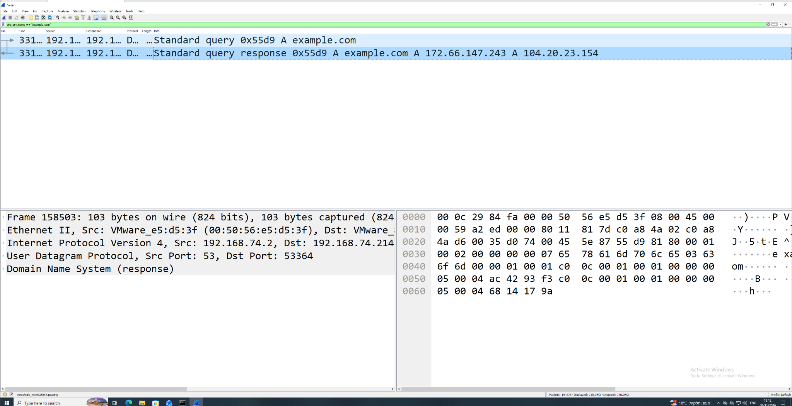
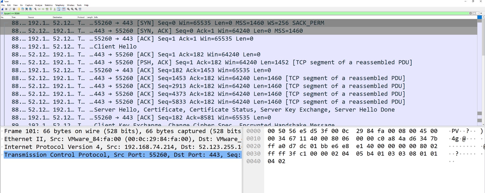

# Network-Traffic-Analysis-Wireshark
Hands-on network traffic investigation using Wireshark: DNS analysis, TCP three-way handshake, and TLS traffic.
# Network Traffic Analysis with Wireshark

## Overview

This project demonstrates a hands-on network traffic investigation performed in a controlled Windows lab environment using Wireshark.

The goal was to capture and analyze network traffic, understand DNS resolution, identify a TCP three-way handshake, observe the beginning of a TLS session, and interpret the traffic from a security analyst perspective.

---

## Objective

The investigation focused on:

- Capturing live network traffic from a Windows virtual machine
- Analyzing DNS queries and responses
- Identifying source and destination IP addresses and ports
- Understanding DNS A records
- Identifying a TCP three-way handshake
- Observing the transition from TCP to TLS
- Correlating network events to understand the connection flow
- Determining whether the observed activity showed signs of malicious behavior

---

## Environment

- Windows 10 Virtual Machine
- VMware
- Wireshark
- Command Prompt
- DNS
- TCP/IP
- TLS/HTTPS

---

## Investigation

### 1. DNS Query Analysis

A controlled DNS lookup for `example.com` was generated and captured in Wireshark.

Display filter:

```text
dns.qry.name == "example.com"
```

The captured query showed:

- Source IP: `192.168.74.214`
- Destination IP: `192.168.74.2`
- Protocol: UDP
- Source Port: `53364`
- Destination Port: `53`
- Query Type: `A`
- Requested Domain: `example.com`

The Windows VM sent the request to its configured DNS resolver asking for the IPv4 address associated with `example.com`.

### Evidence 1 — DNS Query



---

### 2. DNS Response Analysis

The DNS response reversed the communication direction:

- Source IP: `192.168.74.2`
- Destination IP: `192.168.74.214`
- Source Port: `53`
- Destination Port: `53364`

The DNS resolver returned two IPv4 addresses for `example.com`:

- `172.66.147.243`
- `104.20.23.154`

The matching DNS transaction demonstrated the normal request/response process between the client and DNS resolver.

### Evidence 2 — DNS Response



---

## 3. TCP Connection Analysis

TCP traffic was then analyzed to identify connection establishment.

A specific TCP conversation was isolated using a Wireshark display filter:

```text
tcp.port == 55260
```

The capture showed the TCP three-way handshake:

1. `SYN` — client initiated the connection
2. `SYN, ACK` — server acknowledged the request
3. `ACK` — client acknowledged the server response

This confirmed that a TCP connection was successfully established.

The destination service used TCP port `443`, commonly associated with HTTPS.

### Evidence 3 — TCP and TLS Traffic



---

## 4. TLS Traffic Analysis

Immediately after the TCP connection was established, the capture showed TLS negotiation traffic including:

- `Client Hello`
- `Server Hello`
- Certificate exchange
- Server key exchange

This demonstrated the transition from:

**TCP connection establishment → TLS negotiation → encrypted application communication**

Because the application traffic is protected by TLS, the content of the later HTTPS communication is not directly readable from the packet capture without additional decryption capabilities.

---

## Analyst Findings

The investigation demonstrated a normal network communication flow:

**DNS Resolution → IP Address Identification → TCP Connection → TLS Negotiation → Encrypted Communication**

Key observations:

- DNS traffic used UDP destination port `53`
- The client initiated DNS resolution before communicating with external services
- DNS responses returned IP addresses associated with the requested domain
- TCP communication used the standard three-way handshake
- HTTPS-related communication used TCP port `443`
- TLS negotiation occurred after TCP connection establishment
- No evidence in the analyzed traffic alone was sufficient to classify the activity as malicious

---

## Analyst Verdict

**Classification:** Normal / Expected Network Activity

**Malicious Activity Confirmed:** No

**Reasoning:**  
The analyzed packets demonstrated expected DNS, TCP, and TLS behavior. No suspicious connection pattern or other evidence observed in this investigation was sufficient to classify the activity as malicious.

In a real SOC investigation, additional context would be required before making a security decision, including:

- Destination reputation
- Domain reputation
- Process responsible for the connection
- Endpoint telemetry
- Connection frequency and volume
- Authentication activity
- Related SIEM or EDR alerts

---

## Security Relevance

Network traffic analysis is useful in SOC investigations because it helps analysts understand:

- Which host initiated a connection
- Which external systems were contacted
- Which ports and protocols were used
- Which domains were resolved
- Whether connections were successfully established
- Whether traffic patterns are consistent with expected or suspicious behavior

Network evidence should be correlated with endpoint, authentication, and security telemetry before determining whether an event represents malicious activity.

---

## What I Learned

Through this lab I practiced:

- Wireshark packet capture and display filters
- DNS query and response analysis
- DNS A record interpretation
- Source and destination IP analysis
- UDP and TCP port analysis
- TCP three-way handshake analysis
- Basic TLS handshake analysis
- Network event correlation
- Distinguishing observed evidence from assumptions
- Writing an evidence-based analyst conclusion

---

## Tools & Skills

`Wireshark` `Windows 10` `TCP/IP` `DNS` `UDP` `TCP` `TLS` `HTTPS` `Packet Analysis` `Network Traffic Analysis` `SOC Analysis`
